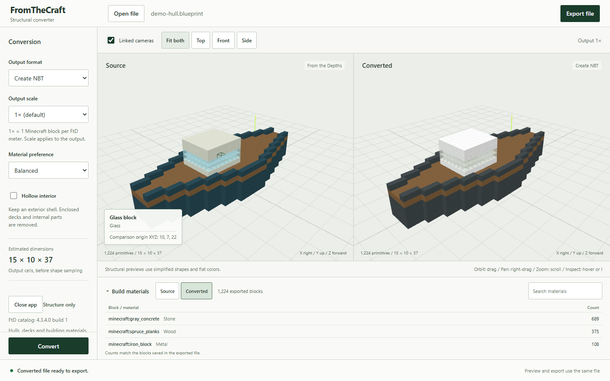

# FromTheCraft

Convert structures between From the Depths `.blueprint` files and Minecraft Java 1.21.1 Create `.nbt` or Litematica `.litematic` files.

FromTheCraft runs locally on Windows. It converts hulls, decks and building materials.



## Download and run

1. Open the [latest Windows release](https://github.com/Clement-Wright/FromTheCraft/releases/latest) and download the Windows ZIP under Assets. The current release is [v0.3.0](https://github.com/Clement-Wright/FromTheCraft/releases/tag/v0.3.0).
2. Extract the entire ZIP to a folder.
3. Open `FromTheCraft.exe` in the extracted folder.

The launcher opens your browser on a free loopback port. Conversion stays on your computer, with no accounts, analytics, CDN assets or external network calls. Use **Close app** to stop the service, or close the browser tab and let it stop after three minutes without a browser heartbeat.

Try the included [demo hull](examples/demo-hull.blueprint) if you want a small starting file. The [examples folder](examples) also contains its NBT and Litematic exports.

## Convert a structure

Open or drop a `.blueprint`, `.nbt` or `.litematic` file. For an FtD source, choose **Create NBT** or **Litematic**. Minecraft sources convert to **FtD blueprint**. Choose the output scale and, for Minecraft output, a material preference: **Balanced**, **Material first** or **Color first**.

Click **Convert**, inspect both views, then click **Export file**. Hover over either preview to see the block name, material, and state. You can also focus a viewer and press **I** to inspect its center. These coordinates describe the displayed origin, which can differ from an FtD block's saved anchor.

The **Build materials** list counts source parts or exported blocks. A 4 m source beam counts as one part. The converted list counts the actual serialized blocks, grouping their facing and other placement states under the same block name. Search the list or collapse it to give the previews more space. Linked cameras help you check the same area in both views. Changing the source or conversion options clears the previous export until you convert again.

All five scales work in both directions: 4×, 2×, 1×, 0.5× and 0.25×. At 1×, one Minecraft block equals one FtD meter. Smaller scales merge occupied cells and can remove small openings or thin details. Estimated dimensions appear before conversion. Large 4× results may exceed the limits below.

**Hollow interior** is optional and off by default. Set a shell thickness of 1 to 4 output cells to keep a shell along surfaces that face outside air. Air reaches inward through openings, so the shell can follow open passages. Enclosed interior decks and parts may disappear when you enable hollowing.

### Vanilla and Create add-ons

Leave **Installed mods** at **Vanilla only** for vanilla building blocks. If a selected material has no matching slab or stair, conversion uses its full block. Painted red slopes no longer turn into stone stairs or slabs.

For modded output, open **Installed mods** and check the mods in your pack. The profile targets **Minecraft 1.21.1, NeoForge and Create 6.0.10**. It includes Copycats+, Design n' Decor, Create: Chipped, Encased, Deco, Chipped, and Bells & Whistles. Dependencies are selected automatically. FromTheCraft doesn't install mods.

**Create: Copycats+** preserves partial-block shapes with the selected material applied to copycat stairs and slabs. Their NBT includes the material state and consumed item. The other enabled palettes offer 63 solid blocks across Create and its add-ons, plus verified matching shape variants. The converter uses them when they match the source color more closely.

The inspector and build list show each copycat's **Applied material**, with separate searchable rows for different materials. Counts describe exported blocks, not survival crafting costs. Previews use flat colors; Minecraft supplies textures from your installed mods and resource packs. See [mod versions and format checks](docs/mod-compatibility.md) for the exact profiles and unverified in-game behavior.

## How conversion works

The source preview uses native structural primitives independently of the target grid. FtD beams occupy their full footprints, and nested child transforms compose continuously before the converter samples the geometry at the selected scale. The first occupied contribution wins when parts overlap.

After sampling, the converter assigns building materials and writes the target format. It reads those exact bytes back to make the converted preview and caches them for export.

Native FtD slopes, wedges and corners use distinct convex shape definitions. Their local direction comes from checks against installed game meshes. the source viewer and converter share those definitions. Axis-aligned Minecraft output uses matching stairs and slabs, matching full blocks, or enabled copycats. Minecraft stairs become ordinary FtD slopes at 1×. Half slabs become 1 m blocks at that scale, while 2× preserves their half-height geometry. FtD paint uses RGB blended by its saved paint-strength channel. Glass transparency follows the material class. Previews use flat colors and simplified geometry instead of game textures.

## Conversion limits

Mimics and recognized decoration overlays are skipped. Special blocks receive approximations or omissions with notices. Fluids, entities, stored item inventories and gameplay payloads are ignored. Known copycat appearance data is read for structural conversion. Unknown modded blocks use placeholders.

Minecraft input must have data version **3955**, for **Java 1.21.1**. Other versions receive an error. Litematic input supports format versions 5–7; output uses version 6.

FtD output follows the inspected **3.8.5.11** blueprint schema, also checked against installed blueprint schemas saved by 4.2.5.2 and 4.3.1.11. The bundled MIT catalog is a fallback, with versioned native-shape corrections for ambiguous IDs. When available, FromTheCraft reads the installed game's `Core_*` item metadata and inherited beam footprints locally. This was checked against **4.3.4.0 build 1**, including stock blueprints. Set `FROMTHECRAFT_FTD` to the game folder or `StreamingAssets` folder for another installation. The older bundled catalog omits some newer IDs when the game isn't installed. The app reports those omissions. No game files are copied or bundled. Ordinary curved-hull shapes and thin plate slopes still use limited approximations. FtD version compatibility and in-game acceptance need further checks.

Limits are 32 MiB per uploaded file, 128 MiB decompressed NBT, 500,000 occupied output cells, 2,048 cells per axis, and an 8,000,000-cell bounding volume.

## Development

Use Python 3.12 and Node 22 or newer on Windows. From the repository folder:

```powershell
uv sync --python 3.12 --extra dev
Set-Location ui
npm.cmd ci
npm.cmd run build
Set-Location ..
.venv\Scripts\python -m fromthecraft
```

Tests and Windows packaging:

```powershell
.venv\Scripts\python -m pytest
.venv\Scripts\ruff check src scripts tests
.venv\Scripts\python -m fromthecraft --no-browser --port 8765
# In another terminal:
Set-Location ui
npx.cmd playwright install chromium
npm.cmd test
# From the repository folder:
powershell -ExecutionPolicy Bypass -File scripts\build_windows.ps1
```

## License and acknowledgments

GPL-3.0-or-later. See [COPYING](COPYING). Litemapy 0.11.0b0 is GPL-3.0 and supplies the Litematic adapter. nbtlib 2.0.4 handles binary NBT. Three.js 0.180.0 provides instancing and orbit controls. React supplies the interface. The [FtD-Blueprint-Bot catalog](https://github.com/FRUCHTBA3R/FtD-Blueprint-Bot/tree/a7c162bec615f277fa1eeecdbaf9d4680d5ac2e4) is reused under MIT with its notice. The Minecraft registry comes from [minecraft-data 3.100.0](https://github.com/PrismarineJS/minecraft-data), also MIT. Full dependency notices ship inside the portable folder. No game assets or third-party blueprints are bundled.
