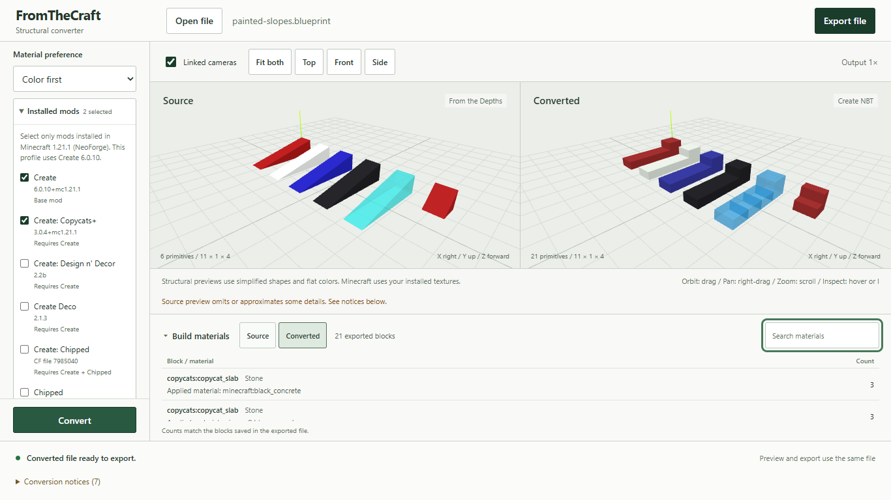

# Minecraft mod profiles

The profiles target Minecraft Java **1.21.1**, data version **3955**, **NeoForge**, and **Create 6.0.10**. The dropdown starts empty. Enabling an add-on also selects its dependencies among the supported mods. Install the mods and their own dependencies in Minecraft; FromTheCraft only writes their block IDs and safe appearance data.

| Mod | Inspected version | Palette |
| --- | --- | --- |
| [Create](https://modrinth.com/mod/create/version/UjX6dr61) | 6.0.10 | 12 solid blocks, 14 matching variants |
| [Create: Copycats+](https://github.com/copycats-plus/copycats/tree/9f808ac0b437817696c50f2e8b57f590b1196094) | 3.0.4+mc1.21.1 | Applied-material stairs and slabs |
| [Create: Design n' Decor](https://www.curseforge.com/minecraft/mc-mods/create-design-n-decor) | 2.2b | 12 solid blocks, 12 matching variants |
| [Create Deco](https://modrinth.com/mod/create-deco) | 2.1.3 | 12 solid blocks, 14 matching variants |
| [Create: Chipped](https://www.curseforge.com/minecraft/mc-mods/create-chipped/files/7985040) | File 7985040 | 12 solid blocks |
| [Chipped](https://modrinth.com/mod/chipped) | 4.0.2 | 12 solid blocks |
| [Create Encased](https://modrinth.com/mod/create-encased) | 1.21.1-1.9.0-ht3 | Zinc casing |
| [Create: Bells & Whistles](https://modrinth.com/mod/bellsandwhistles) | 0.4.7-1.21.1 | Two metro casings |

Create: Chipped's inspected file has conflicting version labels: the release title says 1.1.0, its filename says 1.2.0, and embedded metadata says 1.0.0. The profile therefore identifies the exact file and SHA-512. It requires Create and Chipped. Encased's inspected version requires Create 6.0.10 or newer. Chipped also needs Resourceful Lib and Athena; install the dependencies specified by each mod's release.

The [bundled registry](https://github.com/Clement-Wright/FromTheCraft/blob/main/src/fromthecraft/data/mod_palette_1_21_1.json) records release links, hashes, embedded version/license/dependency declarations, block IDs, state values and model/texture paths. The 63 palette entries are solid cubes with opaque face textures. The 40 matching slab/stair variants were checked for matching texture families or direct crafting recipes. Numeric preview colors are average sRGB samples from the first texture frame, weighted over the six cube faces. Resource packs can change their appearance. Mod functionality is not converted.

Visual model variants omit some runtime properties. The sheet-metal entries also include the four connection booleans registered by Create's `ConnectedPillarBlock`, verified from the pinned mod classes. Unfamiliar mod input properties receive an approximation notice while valid orientation is kept; generated output remains strictly validated.

## Copycat format

Copycats+ has two different serializers. These fields were checked against [revision 9f808ac](https://github.com/copycats-plus/copycats/tree/9f808ac0b437817696c50f2e8b57f590b1196094):

| Geometry block | Block entity ID | Appearance data |
| --- | --- | --- |
| `copycats:copycat_stairs` | `copycats:copycat` | `Material`, `Item`, `EnableCT` |
| `copycats:copycat_slab` | `copycats:multistate_copycat` | `material_data.bottom` / `.top`: `material`, `consumedItem`, `enableCT` |

Materials store the applied block's `Name` and optional `Properties`. Item stacks use lowercase `count` as an integer, following the [Minecraft item-stack format introduced in 1.20.5](https://www.minecraft.net/en-us/article/minecraft-java-edition-1-20-5). Empty stacks are empty compounds. Generated partial slabs leave the inactive half at `create:copycat_base` with an empty consumed item. Connected textures are enabled on generated copycats. The file references the applied block; it embeds no texture images.

Exports use straight stairs and slabs along any of the three axes. Thin slope tips retain their sampled partial shape, including after rotation. Reverse imports also read the inspected stair shapes and slab axes. Different materials on the two halves of a double slab are reported as an unsupported material combination and receive an inert placeholder. The reader requires a matching consumed item; some manually edited or migrated material-only copycats therefore receive a notice. Reverse conversion uses geometry and applied material; connected-texture toggles and gameplay state do not carry into FtD.



Structure NBT attaches block entity compounds under each block's `nbt` field. Litematic stores them directly in each region's `TileEntities` list. Signed region dimensions need an offset from the minimum corner before associating a tile entity with its block. The inspected [Litematica 1.21.1 reader](https://github.com/maruohon/litematica/blob/dc426db5b2ff93cc56790287d203d03944facf5d/src/main/java/fi/dy/masa/litematica/schematic/LitematicaSchematic.java) supports the same structural fields through format version 7. FromTheCraft accepts versions 5–7 and writes version 6, always requiring Minecraft data version 3955.

## Reproduce the checks

The original four-block fixtures contain red concrete stairs, glass stairs, blue concrete slabs and cyan stained-glass slabs. They were authored from the inspected schema, independently of the application's writer. They are not captures from Minecraft. Run:

```powershell
node scripts\verify_copycats.cjs
.venv\Scripts\python -m pytest tests/test_copycats.py
.venv\Scripts\python scripts/verify_mod_registry.py path\to\pinned-mod-jars
.venv\Scripts\python -m fromthecraft convert input.blueprint output.nbt --mod copycats --mod create-deco
```

The JavaScript check uses prismarine-nbt, compares complete block-entity payloads and checks integer item counts and byte CT flags. The registry checker verifies jar hashes, blockstate definitions and texture-path existence without downloading anything. The sibling-file Litematic checker also compares every block entity with structure NBT, as well as independently unpacking its block palette.

These checks establish file encoding and agreement with inspected schemas. **Minecraft placement, Schematicannon material use, connected-texture rendering and Litematica placement have not been tested in game.** Modpack tags can change which applied materials copycats accept.

## Licensing

No mod jars, source implementations, models or texture images are distributed with FromTheCraft. The bundled data contains block identifiers, numeric color measurements and format facts. Create and Design n' Decor separate code and asset licensing; Copycats+ reserves its rights. Chipped declares restricted licensing. Create Deco's Modrinth metadata says MIT while its inspected jar declares All Rights Reserved; the registry retains both declarations. Create: Chipped declares CC BY-NC 3.0, Encased MIT, and Bells & Whistles GPL-3.0-or-later. The app implements the small appearance serializers itself and does not include these mods as dependencies.
